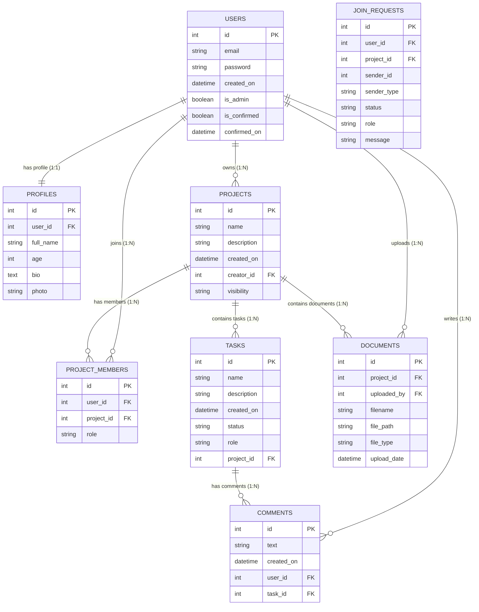

# 🎓 Research Collaboration & Paper Management Platform
## Complete Master Handbook & College Project Defense Guide

---

# 📋 Project Identification & Meta Details

- **Project Title:** Research Collaboration and Paper Management Platform
- **Base Open-Source Project:** `flask-project-tracker` (Python, Flask, SQLAlchemy)
- **Project Team:**
  - **Amritha DB** — `24BCE5064`
  - **Mokshita CV** — `24BCE1094`
  - **Smrithi S** — `24BCE1698`
- **Institution:** VIT Chennai
- **Target Submission:** Academic College Project Review & Evaluation

---

# 📖 TABLE OF CONTENTS

1. [Fundamental Web Concepts (Zero-Pre-requisite Primer)](#1-fundamental-web-concepts)
2. [What is This Project? (Problem & Solution)](#2-what-is-this-project)
3. [System Architecture & How Everything Connects](#3-system-architecture)
4. [File-by-File Codebase Tour](#4-file-by-file-codebase-tour)
5. [The Tech Stack Deep Dive (What, Why & How)](#5-the-tech-stack-deep-dive)
6. [Database Schema & Data Relationships Explained](#6-database-schema)
7. [Detailed Breakdown of Every Implemented Feature](#7-feature-deep-dive)
8. [Security Mechanisms Explained Simply](#8-security-mechanisms)
9. [PDF Metadata Extraction Engine](#9-pdf-metadata-extraction-engine)
10. [Code Snippets Explained Line-by-Line](#10-code-snippets-explained)
11. [The 20 Most Common Viva / Review Questions & Answers](#11-viva-qa-guide)
12. [Step-by-Step Live Demo Script for Evaluators](#12-live-demo-script)

---

# 1. 🌐 Fundamental Web Concepts (Zero-Pre-requisite Primer)

If you are an absolute beginner to web development, let us first explain the core concepts in very simple language.

### A. What is a "Client" and a "Server"?
- **The Client (Your Browser):** When you open Chrome or Safari and visit `http://127.0.0.1:5000`, your browser is the **Client**. It asks for web pages, displays buttons, colors, and forms, and sends user clicks and typed data over the internet or your local network.
- **The Server (Our Python/Flask Code):** The **Server** is a Python program running on a computer (your laptop). It listens for requests from the browser, runs logic (e.g., *"Is this password correct?"* or *"Save this PDF"*), fetches information from the database, and creates HTML pages to send back to the browser.

### B. What is HTTP and Request-Response?
- When you click a button on a website, your browser sends an **HTTP Request** (like a letter asking for information).
  - **`GET` Request:** Used to retrieve data (e.g., *"Please give me the project details page"*).
  - **`POST` Request:** Used to send data to the server to make changes (e.g., submitting a login form, creating a task, or uploading a research paper).
- The server processes this and returns an **HTTP Response** (the HTML web page, a file download, or a redirect to another page).

### C. What is a Database?
- A database (in our case, **PostgreSQL**) is a dedicated system that permanently stores structured information in tables (with rows and columns), so data is not lost when the web server restarts.

### D. What is an ORM (Object-Relational Mapping)?
- Normally, to talk to a database, you must write raw database queries in SQL like:
  ```sql
  SELECT * FROM projects WHERE creator_id = 2;
  ```
- An **ORM** (like **SQLAlchemy**) allows you to write standard Python code instead:
  ```python
  projects = Project.query.filter_by(creator_id=2).all()
  ```
- The ORM automatically converts Python objects into database rows and vice versa, which prevents typos, prevents hacking (SQL injection), and makes development much faster.

---

# 2. 🎯 What is This Project? (Problem & Solution)

### The Real-World Problem
In universities, students and professors collaborate on research projects (capstone projects, research papers, conference submissions). Currently, teams use fragmented, disconnected tools:
1. **WhatsApp / Telegram / Discord:** Used for team communication. But important discussions, shared research links, and files quickly get lost in thousands of daily chat messages.
2. **Google Drive / Dropbox:** Used for saving PDF research papers. But files are just sitting in folders with no connection to which student is responsible for reading them or which task they relate to.
3. **Trello / Notion / Excel Sheets:** Used for tracking tasks and to-do lists, completely separate from where the actual papers are stored.
4. **Email:** Used for formal announcements and invites, creating messy inboxes and slow response times.

### Our Solution
The **Research Collaboration and Paper Management Platform** is a web-based ecosystem that brings the entire academic research lifecycle into **one single, unified platform**:
- **Project Initiation:** Create private or public research projects with titles, descriptions, and timelines.
- **Academic Team Formation:** Assign specific roles suited to academia (*Lead Researcher*, *Member*, *Faculty Guide*) and manage join requests.
- **Task Tracking & Milestones:** Break down research into actionable tasks, assign them to team members, set deadlines, and update status (*To Do*, *In Progress*, *Completed*).
- **Contextual Discussions:** Hold discussion threads directly inside tasks so comments stay tied to the specific task rather than getting lost in group chats.
- **Document Management & PDF Extraction:** Upload research papers, store them safely, share them with project teammates, and automatically extract paper metadata (Title, Authors, Domain, Abstract, Keywords, Conclusions, etc.) using Python's `PyMuPDF`.
- **Personalized Dashboard:** A single consolidated home page where every student/faculty member can see their active projects, assigned tasks, and recently shared literature.

---

# 3. 🏛️ System Architecture & How Everything Connects

Our project follows the **Model - View - Template (MVT / MVC)** architectural pattern and uses Flask **Blueprints**:

```
                              ┌────────────────────────────────────────┐
                              │            USER BROWSER                │
                              │ (HTML, CSS, Bootstrap, Jinja2 Render)  │
                              └────────────────────┬───────────────────┘
                                                   │ HTTP Request
                                                   │ (GET / POST)
                                                   ▼
┌──────────────────────────────────────────────────────────────────────────────────────────────┐
│                                   FLASK APPLICATION (`main.py`)                              │
│                                                                                              │
│   ┌──────────────────┐  ┌──────────────────┐  ┌──────────────────┐  ┌────────────────────┐   │
│   │ accounts_bp      │  │ projects_bp      │  │ tasks_bp         │  │ documents_bp       │   │
│   │ (Login/Register) │  │ (Projects/Teams) │  │ (Tasks/Comments) │  │ (Upload/Download)  │   │
│   └────────┬─────────┘  └────────┬─────────┘  └────────┬─────────┘  └─────────┬──────────┘   │
│            │                     │                     │                      │              │
│            ▼                     ▼                     ▼                      ▼              │
│      Flask-Bcrypt           Flask-Login            Flask-WTF               PyMuPDF           │
│      (Password Salt)     (Session Manager)     (CSRF Validation)      (PDF Extraction)       │
└──────────────────────────────────────────┬───────────────────────────────────────────────────┘
                                           │ ORM (SQLAlchemy)
                                           ▼
┌──────────────────────────────────────────────────────────────────────────────────────────────┐
│                                     POSTGRESQL DATABASE                                      │
│                                                                                              │
│   [users] ───< [profiles]                                                                    │
│      │                                                                                       │
│      ├───< [projects] ───< [tasks] ───< [comments]                                           │
│      │         │                                                                             │
│      │         ├───< [project_members]                                                       │
│      │         ├───< [join_requests]                                                         │
│      │         └───< [documents] (metadata)                                                  │
└──────────────────────────────────────────┬───────────────────────────────────────────────────┘
                                           │ File Storage
                                           ▼
                              ┌────────────────────────────────────────┐
                              │       FILESYSTEM (`uploads/` folder)   │
                              │    Stores raw PDF / image / ZIP files  │
                              └────────────────────────────────────────┘
```

### What are Blueprints?
In Flask, a **Blueprint** is a way to organize a large web application into smaller, independent modules. Instead of putting hundreds of routes in one file, we organize our app into logical sections:
- `accounts_bp` handles everything related to users and accounts.
- `projects_bp` handles creating, editing, and viewing projects and teams.
- `tasks_bp` handles editing and deleting tasks.
- `documents_bp` handles uploading, downloading, and deleting files.
- `core_bp` handles the home page and dashboard.

---

# 4. 📁 File-by-File Codebase Tour

Let us explore every important folder and file in your repository:

```
flask-project-tracker/
│
├── main.py                     # Entry point. Starts the local server (`python3 main.py`).
├── config.py                   # Configuration settings (Database URL, Secret Keys, Upload folder).
├── requirements.txt            # List of all Python libraries required by this project.
│
├── migrations/                 # Alembic database migration scripts (tracks schema changes).
│   └── versions/               # Individual version files (e.g. 5c3dcd2dd586_add_documents_table.py).
│
├── uploads/                    # Physical folder on disk where uploaded files are safely stored.
│
└── website/                    # The main Python package containing the application logic.
    ├── __init__.py             # App factory: initializes Flask, Database, LoginManager, Bcrypt, Blueprints.
    │
    ├── accounts/               # MODULE 1: AUTHENTICATION & PROFILES
    │   ├── models.py           # Defines `User` and `Profile` database tables.
    │   ├── forms.py            # WTForms for Login, Registration, and Profile edit.
    │   ├── views.py            # Routes: `/login`, `/register`, `/logout`, `/profile`, `/profile/edit`.
    │   └── token.py            # Utility for generating secure tokens.
    │
    ├── projects/               # MODULE 2: PROJECTS & TEAMS
    │   ├── models.py           # Defines `Project`, `ProjectMember`, `JoinRequest`, `Task`, `Comment`.
    │   ├── forms.py            # WTForms for Project creation, Member invites, Join requests.
    │   └── views.py            # Routes: `/projects`, `/projects/create`, `/projects/<id>`, member actions.
    │
    ├── tasks/                  # MODULE 3: TASK MANAGEMENT
    │   ├── forms.py            # WTForms for Task creation, status updates, and comments.
    │   └── views.py            # Routes: `/task/<id>/edit`, `/task/<id>/delete`.
    │
    ├── documents/              # MODULE 4: DOCUMENT MANAGEMENT
    │   ├── models.py           # Defines `Document` table in PostgreSQL.
    │   ├── forms.py            # WTForms for Document upload (`DocumentUploadForm`).
    │   └── views.py            # Routes: `/projects/<id>/documents`, `/upload`, `/download`, `/delete`.
    │
    ├── core/                   # MODULE 5: HOME & DASHBOARD
    │   └── views.py            # Routes: `/` (Home page / Dashboard).
    │
    ├── templates/              # Jinja2 HTML Templates (Rendered by the server).
    │   ├── _base.html          # Master HTML wrapper (contains navbar, Bootstrap CDN, footer).
    │   ├── navigation.html     # Top navigation bar component.
    │   ├── accounts/           # HTML files for login, register, profile.
    │   ├── projects/           # HTML files for project list, project details, requests.
    │   ├── tasks/              # HTML files for task details and comments.
    │   ├── documents/          # HTML files for document library (`documents.html`, `upload_document.html`).
    │   └── errors/             # Custom error pages (401, 404, 500).
    │
    ├── static/                 # Static assets (Custom CSS stylesheets, icons, images).
    └── utils/                  # Decorators (e.g. `@logout_required`, `@check_is_confirmed`) and email helpers.
```

---

# 5. 🧰 The Tech Stack Deep Dive (What, Why & How)

Here is a detailed breakdown of every single library in your `requirements.txt`:

### 1. Flask (`Flask==3.0.2`)
- **What it is:** A micro web framework in Python.
- **Why we used it:** It is lightweight, unopinionated, and extremely fast. It does not force complicated directory structures or unnecessary background services. It is ideal for clean, modular web apps using Blueprints.
- **What happens if we didn't have it:** We would have to manually parse raw HTTP sockets, headers, and TCP streams in Python from scratch.

### 2. PostgreSQL (`psycopg2-binary==2.9.9`)
- **What it is:** An enterprise-grade, open-source Relational Database Management System (RDBMS).
- **Why we used it:** It enforces relational integrity (foreign keys), ACID transactions (atomicity, consistency, isolation, durability), and reliably stores our users, projects, tasks, and file records.

### 3. Flask-SQLAlchemy (`SQLAlchemy==2.0.29`, `Flask-SQLAlchemy==3.1.1`)
- **What it is:** An Object-Relational Mapper (ORM).
- **Why we used it:** It allows us to define database tables as standard Python classes and queries as method calls (`Project.query.all()`). It completely protects the application against SQL Injection hacks by parameterizing queries automatically.

### 4. Flask-Migrate & Alembic (`Flask-Migrate==4.0.5`, `alembic==1.13.1`)
- **What it is:** Database schema version control.
- **Why we used it:** As we build new features (like adding research paper metadata to the `documents` table), we need to update the PostgreSQL table structure. Flask-Migrate generates migration scripts that alter tables without wiping or deleting existing users or projects.

### 5. Flask-Login (`Flask-Login==0.6.3`)
- **What it is:** User session authentication manager.
- **Why we used it:** It provides `login_user()`, `logout_user()`, and the `current_user` global object. It also provides the `@login_required` decorator that we place above sensitive routes so unauthenticated guests are automatically redirected to the login page.

### 6. Flask-Bcrypt (`Flask-Bcrypt==1.0.1`, `bcrypt==4.1.2`)
- **What it is:** Cryptographic password hashing library based on the Blowfish cipher.
- **Why we used it:** Security standard. It uses **salting** (adding random characters to passwords before hashing) with multiple rounds of computation. This guarantees that passwords can never be converted back into plaintext even if an attacker gains access to the database.

### 7. Flask-WTF & WTForms (`Flask-WTF==1.2.1`, `WTForms==3.1.2`)
- **What it is:** Web form creation, validation, and CSRF protection.
- **Why we used it:** It validates that email addresses have valid formats, required fields are not left empty, and uploaded files match permitted file types. It automatically injects hidden **CSRF tokens** into every form to stop cross-site forged requests.

### 8. PyMuPDF (`pymupdf==1.26.5` / `fitz`)
- **What it is:** High-performance C-backed PDF parsing and extraction engine for Python.
- **Why we used it:** It allows us to inspect uploaded research paper PDFs, read their document properties (title, author, subject, keywords), count pages, and extract textual sections (Abstract, Research Gaps, Future Work, Conclusion).

### 9. Jinja2 & Bootstrap
- **What it is:** Jinja2 is Flask's HTML templating engine; Bootstrap is the CSS responsive design framework.
- **Why we used it:** Jinja2 lets us write loops and conditionals in HTML (e.g. ``). Bootstrap gives us responsive cards, navigation bars, tables, and buttons without writing thousands of lines of raw CSS.

---

# 6. 🗄️ Database Schema & Data Relationships Explained

Our PostgreSQL database currently uses **8 interconnected tables**:



### Table Relationships Explained in Plain English:
1. **One-to-One (`1:1`) Relationship:**
   - Each `User` has exactly one `Profile` record.
2. **One-to-Many (`1:N`) Relationship:**
   - One `User` can create many `Projects`.
   - One `Project` can have many `Tasks`.
   - One `Project` can have many `Documents`.
   - One `Task` can have many `Comments`.
3. **Many-to-Many (`M:N`) Relationship:**
   - Users can be members of multiple projects, and projects have multiple users. This is bridged using the `project_members` join table, which also stores each user's specific `role` in that project.
4. **Cascade Deletes (`cascade='all, delete-orphan'`):**
   - If a project is deleted, SQLAlchemy automatically deletes all associated tasks, comments, member links, and document metadata so no orphaned, corrupted records remain in the database.

---

# 7. 🚀 Detailed Breakdown of Every Implemented Feature

### 1. User Authentication (`website/accounts/views.py`)
- **Registration (`/register`):**
  1. Validates email and password length.
  2. Generates a Bcrypt salted password hash.
  3. Creates a `User` record and an initial `Profile` record with a default avatar (`default_photo.jpg`).
  4. **Local Dev Modification:** Sets `is_confirmed = True` and logs the user in immediately so local development and project review do not get blocked by external SMTP email issues.
- **Login (`/login`):**
  1. Looks up the user by email in PostgreSQL.
  2. Calls `bcrypt.check_password_hash()` to securely verify credentials.
  3. Calls `login_user(user)` to establish an encrypted session cookie.
- **Logout (`/logout`):**
  1. Destroys the user session via `logout_user()` and redirects to the login screen.
- **Profile Management (`/profile`, `/profile/edit`):**
  1. Displays the user's details and profile picture.
  2. Allows updating name, age, bio, and uploading a new profile picture to `uploads/`.

### 2. Project Creation & Management (`website/projects/views.py`)
- **Create Project (`/projects/create`):**
  1. User enters project title, description, and visibility (`public` or `private`).
  2. Checks that the user does not already have a project with the same name.
  3. Saves the project with `creator_id = current_user.id`.
  4. Automatically inserts a row into `project_members` with role `creator`.
- **View Projects (`/projects`):**
  1. Queries PostgreSQL for projects where `creator_id == current_user.id` ("Created Projects").
  2. Queries `project_members` for projects the user joined ("Member Projects").
- **Public Discovery (`/projects/public`):**
  1. Shows all projects where `visibility == 'public'`.
  2. Allows non-members to view the overview and submit join requests.
- **Project Details (`/projects/<id>`):**
  1. Checks if the user is the creator, a member, or if the project is public.
  2. Displays team members, tasks, the **Documents** button, and action forms.

### 3. Collaboration & Teaming
- **Join Requests (`/projects/<id>/send_request`):**
  1. Non-members can submit a request with a message and desired role.
  2. Creates a `JoinRequest` record with status `pending`.
- **Reviewing Requests (`/requests`):**
  1. Project creators can view all incoming requests.
  2. Clicking **Accept** moves the applicant to `project_members` and removes the request.
  3. Clicking **Reject** deletes the request.
- **Direct Invitations (`/projects/<id>/invite`):**
  1. Project creators can type the email of an existing registered user and assign their role.
- **Removing Members (`/projects/<id>/remove_member/<member_id>`):**
  1. Restricted strictly to project creators.

### 4. Task Management & Threaded Comments (`website/tasks/` & `website/projects/`)
- **Task Creation (`/projects/<id>/create_task`):**
  1. Creates tasks under a specific project with title, description, assigned role, and status.
- **Task Edit & Delete (`/task/<id>/edit`, `/task/<id>/delete`):**
  1. Allows updating status (`Pending` $\rightarrow$ `In Progress` $\rightarrow$ `Completed`) or description.
- **Task Discussion Thread (`/projects/<id>/tasks/<task_id>`):**
  1. Shows the task details and all comments posted under this task.
  2. Shows each comment's author email and creation timestamp.
- **Adding Comments (`/projects/<id>/tasks/<task_id>/add_comment`):**
  1. Project members can post comments to coordinate.
  2. Authors or project creators can delete comments.

### 5. Document Management System (`website/documents/`) — **Complete & Working**
- **The "Documents" Action Button:**
  - Placed prominently on the Project Details page for both creators and members.
- **File Upload (`/projects/<id>/documents/upload`):**
  1. Validates that the logged-in user is an active member or creator of the project.
  2. Checks that the file extension is in `{'pdf', 'png', 'jpg', 'jpeg', 'zip'}`.
  3. Sanitizes the filename using `secure_filename()`.
  4. Generates a unique UUID filename: `uuid.uuid4().hex + '_' + original_filename`.
  5. Saves the file to the physical `uploads/` folder.
  6. Creates a record in the `documents` PostgreSQL table.
- **Document Library (`/projects/<id>/documents`):**
  1. Displays all documents uploaded to that project in a clean table (Filename, Type, Uploader Email, Upload Date).
- **Secure File Download (`/documents/<id>/download`):**
  1. Checks project membership.
  2. Uses Flask's `send_file()` to safely stream the file to the user's browser with the original filename.
- **Document Deletion (`/documents/<id>/delete`):**
  1. Checks project membership.
  2. Deletes the physical file from the disk if it exists.
  3. Deletes the database record from PostgreSQL.

---

# 8. 🔒 Security Mechanisms Explained Simply

If the evaluator asks *"How is your system secured?"*, here are the 5 layers implemented in our project:

1. **Password Protection (Bcrypt Salting):**
   - Passwords are encrypted before touching the database.
   - Salt rounds prevent "rainbow table" brute-force lookup attacks.
2. **Session Security (Flask-Login):**
   - User sessions are stored in cryptographically signed cookies.
   - Protected routes check `@login_required`.
3. **Cross-Site Request Forgery (CSRF) Tokens:**
   - Flask-WTF generates a unique, unpredictable token for every rendered HTML form.
   - When the form is submitted, Flask verifies this token. If an external malicious website tries to forge a POST request, Flask blocks it with a `400 Bad Request`.
4. **SQL Injection Prevention:**
   - We do not concatenate raw SQL strings. All queries go through SQLAlchemy's parameterized ORM methods.
5. **Secure File Upload Handling:**
   - We check file extensions against a strict whitelist (`pdf`, `png`, `jpg`, `jpeg`, `zip`).
   - We use `secure_filename()` to remove dangerous characters (like `../../etc/passwd`).
   - We use `UUID4` hexadecimal prefixes so duplicate filenames never overwrite existing files.
   - We enforce **Project Membership Authorization** so users cannot access files from projects they do not belong to simply by guessing a URL.

---

# 9. 📄 PDF Metadata Extraction Engine (PyMuPDF)

One of the standout features of this platform is **Intelligent Research Paper Metadata Extraction**.

### Why is this needed?
When researchers upload research paper PDFs, manually typing the title, authors, keywords, publication year, abstract, and research gaps into forms is repetitive and error-prone. Our system automates this using **PyMuPDF (`fitz`)**.

### How it works:
```
Uploaded Research Paper PDF
         │
         ▼
PyMuPDF (`fitz.open()`)
         │
         ├───> Extract Document Properties (Title, Author, Subject, Keywords, Creation Date, Page Count)
         │
         └───> Scan Text Content for Standard Academic Headings:
                 • Abstract
                 • Research Gaps / Limitations
                 • Future Work / Future Directions
                 • Conclusion / Concluding Remarks
         │
         ▼
Populate `Document` Record in PostgreSQL (or fallback gracefully to "Not available")
         │
         ▼
Display on Document Library UI with a clean Bootstrap modal/card
```

---

# 10. 💻 Code Snippets Explained Line-by-Line

### Snippet 1: How Bcrypt Hashes Passwords (`website/accounts/models.py`)
```python
# When a new User object is created:
self.password = bcrypt.generate_password_hash(password, rounds=10).decode("utf-8")
```
- `bcrypt.generate_password_hash`: Takes the user's plaintext password (e.g. `"mySecretPass"`).
- `rounds=10`: Runs the key-derivation algorithm $2^{10} = 1024$ times to slow down brute-force attackers.
- `.decode("utf-8")`: Converts the resulting binary hash into a string to store in PostgreSQL.

---

### Snippet 2: How File Upload Security Works (`website/documents/views.py`)
```python
# 1. Sanitize the filename to strip dangerous paths
original_filename = secure_filename(uploaded_file.filename)

# 2. Extract and check the extension
extension = original_filename.rsplit(".", 1)[-1].lower()
if extension not in ALLOWED_EXTENSIONS:
    flash("This file type is not allowed.", "danger")
    return redirect(...)

# 3. Create a unique filename with UUID
unique_filename = f"{uuid.uuid4().hex}_{original_filename}"

# 4. Save to the disk
file_path = os.path.join(current_app.config["UPLOAD_FOLDER"], unique_filename)
uploaded_file.save(file_path)
```
- `secure_filename`: Turns `"../../hack.pdf"` into `"hack.pdf"`.
- `uuid.uuid4().hex`: Generates a random 32-character hex string (e.g. `9b1deb4d3b7d4bad8b9...`).
- `uploaded_file.save`: Writes the binary file to the `uploads/` folder.

---

### Snippet 3: How Project Membership is Checked (`website/documents/views.py`)
```python
def is_project_member(project):
    # If the user created the project, they are automatically allowed
    if project.creator_id == current_user.id:
        return True

    # Otherwise check if they are in the project_members table
    member = ProjectMember.query.filter_by(
        project_id=project.id,
        user_id=current_user.id,
    ).first()

    return member is not None
```
- This function ensures that even if an unauthorized user types `/projects/5/documents` in their browser, the system checks the database and denies them access.

---

# 11. ❓ The 20 Most Common Viva / Review Questions & Answers

### 1. "What is the primary objective of your project?"
> **Answer:** "To build a centralized academic research collaboration and document management platform that combines project tracking, role-based team management, task tracking, threaded discussions, and automated research paper metadata extraction into a single web application."

### 2. "Why did you choose Flask instead of Django?"
> **Answer:** "Flask is a lightweight, flexible micro-framework. It allows us to structure our project into clean, modular Blueprints without unnecessary default overhead. Python also gives us native access to fast PDF parsing libraries like PyMuPDF."

### 3. "What is the difference between SQLite and PostgreSQL?"
> **Answer:** "SQLite is a file-based database good for simple local scripts. PostgreSQL is a full-featured, client-server relational database that supports concurrent connections, robust foreign key constraints, and ACID transactions, making it ideal for multi-user web applications."

### 4. "What is an ORM and what are its advantages?"
> **Answer:** "ORM stands for Object-Relational Mapping. Flask-SQLAlchemy maps our database tables to Python classes. It prevents SQL injection, simplifies complex joins and relationship handling, and lets us write maintainable Python code instead of raw SQL strings."

### 5. "How does password hashing work in your system?"
> **Answer:** "We use Flask-Bcrypt. Passwords are never stored in plaintext. Bcrypt generates a random cryptographic salt and hashes the password with 10 rounds of computation. When logging in, `check_password_hash` validates the user input against the stored hash."

### 6. "What is CSRF and how do you prevent it?"
> **Answer:** "CSRF (Cross-Site Request Forgery) is an attack where an unauthorized website tricks a logged-in user's browser into performing unwanted actions. We prevent this using Flask-WTF, which injects a unique, encrypted CSRF token into every form that is verified by the server on submission."

### 7. "How do you prevent uploaded files from overwriting each other?"
> **Answer:** "We use Python's `uuid.uuid4().hex` to prepend a unique 32-character hexadecimal identifier to every uploaded filename before saving it to the filesystem."

### 8. "How do you protect project documents from unauthorized users?"
> **Answer:** "Every document route runs an authorization check (`is_project_member`). It queries PostgreSQL to verify whether the logged-in `current_user.id` is either the project's creator or listed in the `project_members` table for that project."

### 9. "What are Blueprints in Flask?"
> **Answer:** "Blueprints are modular sub-applications in Flask. We use Blueprints to separate our code into independent modules: `accounts` (auth), `projects` (project CRUD & teams), `tasks` (task management), `documents` (file management), and `core` (dashboard)."

### 10. "What is the purpose of Jinja2?"
> **Answer:** "Jinja2 is Flask's server-side templating engine. It lets us dynamically insert database data into HTML using variables (e.g. `{{ project.name }}`) and control structures (e.g. ``)."

### 11. "What is Alembic / Flask-Migrate used for?"
> **Answer:** "It is a database migration tool that tracks changes to our SQLAlchemy models over time. It allows us to add new columns or tables to PostgreSQL without dropping the database or losing existing user data."

### 12. "What happens when a project is deleted?"
> **Answer:** "Because we configured `cascade='all, delete-orphan'` on project relationships, SQLAlchemy automatically deletes all related tasks, comments, member records, and document metadata so no orphaned data is left behind."

### 13. "What roles exist in the project?"
> **Answer:** "Our platform is tailored for academic research and supports roles such as **Lead Researcher** (project owner with full management rights), **Member** (collaborator who works on tasks and uploads documents), and **Faculty Guide** (academic supervisor with oversight visibility)."

### 14. "How do task comments work?"
> **Answer:** "Comments are linked via a foreign key `task_id` to a specific task. When a member views a task, the route queries all comments with that `task_id` and displays them in a chronological thread with author names and timestamps."

### 15. "Why did you modify the registration flow for local development?"
> **Answer:** "In production, an activation link is emailed via SMTP. For local development and review demonstrations without relying on external SMTP credentials, we configured the registration route to automatically confirm the account and log the user in immediately."

### 16. "What library is used for PDF processing and why?"
> **Answer:** "We use **PyMuPDF (`fitz`)** because it is lightweight, extremely fast (backed by the MuPDF C engine), and capable of extracting metadata, page counts, and section-by-section text from research papers."

### 17. "What happens if an uploaded PDF is missing metadata or an abstract?"
> **Answer:** "Our extraction system uses defensive fallback logic. If a specific section or metadata field is missing, it gracefully assigns `'Not available'` instead of causing an error or crashing the upload."

### 18. "What HTTP methods are used in your application and when?"
> **Answer:** "`GET` is used for requesting and displaying web pages (like viewing projects or downloading a file), while `POST` is used for state-modifying actions (submitting forms, logging in, creating tasks, uploading or deleting files)."

### 19. "Where are uploaded files stored?"
> **Answer:** "The physical files (PDFs, images, ZIPs) are stored on the server's filesystem in the `uploads/` directory, while their metadata (filename, file path, upload date, uploader, project ID) is stored in the `documents` table in PostgreSQL."

### 20. "What is your team's original contribution versus the base open-source template?"
> **Answer:** "We adapted basic task and auth scaffolding from `flask-project-tracker`. Our original contributions are:
> 1. The **Document Management System** for project-scoped file sharing.
> 2. The **PDF Metadata & Content Extraction Engine** using PyMuPDF.
> 3. The **Personalized Academic Research Dashboard**.
> 4. Restructuring all workflows, terminology, and roles specifically for academic research teams."

---

# 12. 🎬 Step-by-Step Live Demo Script for Evaluators

When presenting your project in front of your evaluator, follow this exact 8-step flow:

1. **Step 1 — Show the Running Server:**
   - Show the terminal running `python3 main.py` at `http://127.0.0.1:5000`.
2. **Step 2 — Register a New Account:**
   - Go to `/register`, enter an email (e.g. `researcher@vit.ac.in`) and password.
   - Click **Sign up** and show how the system automatically confirms the account and redirects to the home page.
3. **Step 3 — View & Edit Profile:**
   - Click **Profile** in the navigation bar.
   - Show the bio, age, and profile photo upload feature.
4. **Step 4 — Create a Research Project:**
   - Click **Your Projects** $\rightarrow$ **Create New Project**.
   - Enter a title (e.g., *"AI in Medical Image Segmentation"*), description, and select *Public*.
5. **Step 5 — Team Collaboration & Inviting Members:**
   - Open the project details page.
   - Show the **Lead Researcher** badge.
   - Invite another registered user by typing their email and choosing their role.
6. **Step 6 — Task Tracking & Threaded Discussion:**
   - Click **Add Task**, enter *"Implement U-Net Baseline"*, assign a role, and submit.
   - Click on the task to open its details page.
   - Post a comment (e.g., *"Dataset downloaded and preprocessed"*). Show the comment appear with the author and timestamp.
7. **Step 7 — Document Management:**
   - Return to the Project Details page and click the **"Documents"** button.
   - Show the Document Library.
   - Click **Upload Document**, choose a research paper PDF, and submit.
   - Show the uploaded file listed in the table with filename, file type, uploader, and timestamp.
8. **Step 8 — Download & Security Verification:**
   - Click **Download** to demonstrate that the file is served securely.
   - Show that logging out blocks access to private project documents.

---

### 🎉 You are now 100% prepared for your review!
Keep this handbook open, review the questions, and you will deliver a confident, flawless presentation.
