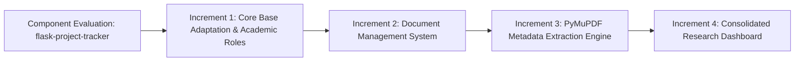
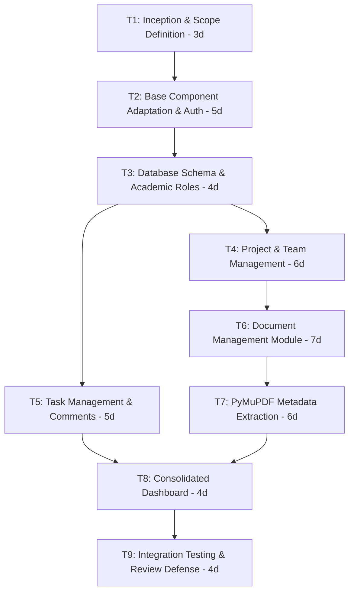
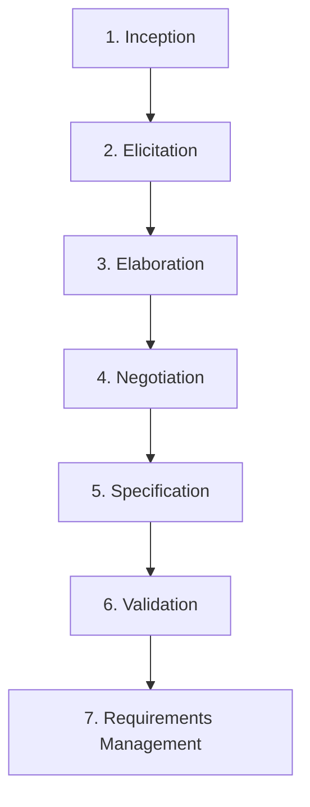
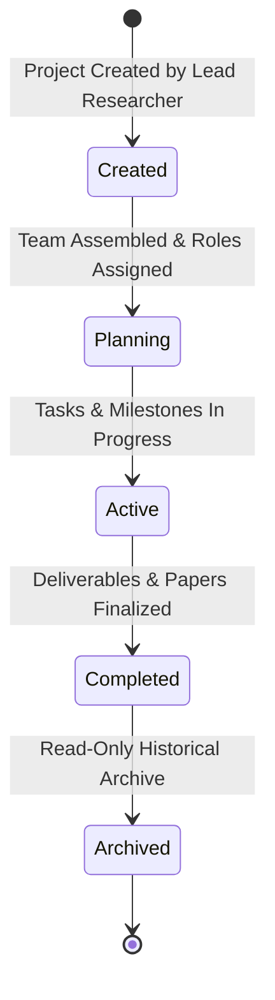
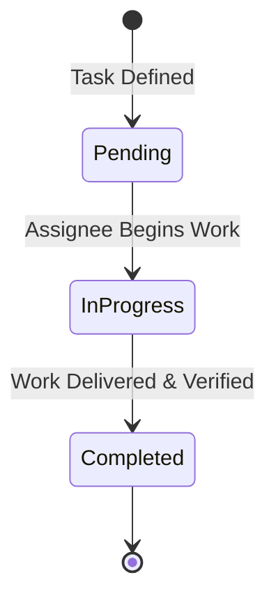

# 📘 Research Collaboration & Paper Management Platform
## Academic Software Engineering Project Handbook
### Aligned with Course Curriculum: **BCSE301L — Software Engineering** (Modules 1, 2, & 3)

---

## 👥 Project & Academic Metadata
- **Course Title:** BCSE301L — Software Engineering
- **Faculty:** Dr. M. Revathi
- **Institution:** School of Computer Science and Engineering (SCOPE), VIT Chennai
- **Project Title:** Research Collaboration and Paper Management Platform
- **Base Open-Source Asset:** `flask-project-tracker` (MIT License)
- **Student Project Team:**
  - **Amritha DB** — `24BCE5064`
  - **Mokshita CV** — `24BCE1094`
  - **Smrithi S** — `24BCE1698`

---

# 📑 TABLE OF CONTENTS

1. [Executive Summary & System Engineering Perspective](#1-executive-summary--system-engineering-perspective)
2. [Module 1 Alignment: Software Process & Evolutionary Models](#2-module-1-alignment-software-process--evolutionary-models)
   - 2.1 Software's Dual Role & Characteristics
   - 2.2 Software Engineering Layers
   - 2.3 Process Framework & Umbrella Activities
   - 2.4 Process Model Selection & Component-Based Development
   - 2.5 Agile Development, XP, Scrum & Kanban Implementation
3. [Module 2 Alignment: Software Project Management & Planning](#3-module-2-alignment-software-project-management--planning)
   - 3.1 The 4 Ps (People, Product, Process, Project)
   - 3.2 4-Dimensional Feasibility Study
   - 3.3 Resource Categorization (Human, Reusable Software, Environment)
   - 3.4 Work Breakdown Structure (WBS) & Task Network
   - 3.5 Project Scheduling, Milestones & Critical Path Analysis (CPM)
   - 3.6 Project Estimation: LOC, Function Points (FP) & COCOMO Models
   - 3.7 Risk Analysis & RMMM Plan (Risk Mitigation, Monitoring & Management)
   - 3.8 Team Dynamics & Communication Pathways
4. [Module 3 Alignment: Requirements Engineering & Modeling](#4-module-3-alignment-requirements-engineering--modeling)
   - 4.1 The 7-Stage Requirements Engineering Process
   - 4.2 User Requirements vs. System Requirements
   - 4.3 Functional Requirements Catalog (REQ-1 to REQ-7)
   - 4.4 Non-Functional Requirements & Metrics (Product, Organizational, External)
   - 4.5 Requirements Completeness, Consistency & Validation
   - 4.6 State Machine Modeling (Project & Task Lifecycles)
5. [Module-by-Module Architectural Analysis (Map & Hint Architecture)](#5-module-by-module-architectural-analysis)
6. [Software Engineering Review Defense Q&A](#6-software-engineering-review-defense-qa)

---

# 1. 🌐 Executive Summary & System Engineering Perspective

### 1.1 The Sociotechnical Problem
From a **System Engineering** perspective, software systems fall into technical systems and **sociotechnical systems** (which encompass hardware, software, and human interactions). 

Academic research teams (students and faculty) operate in a sociotechnical environment where project information, literature, communication, and task coordination are fragmented across disparate communication channels (WhatsApp), cloud file drives (Google Drive), spreadsheets, and emails. This fragmentation introduces process friction, lost research documents, unmonitored deadlines, and severe overhead from manual metadata entry.

### 1.2 The Proposed Solution
The **Research Collaboration and Paper Management Platform** is a web-based sociotechnical solution providing a centralized digital workspace that unifies:
1. **Academic Project & Team Management** (role-aware: *Lead Researcher*, *Member*, *Faculty Guide*)
2. **Task Allocation & Progress Tracking** (To Do $\rightarrow$ In Progress $\rightarrow$ Completed)
3. **Contextual Discussion Threads** scoped directly to tasks
4. **Document Storage & Distribution** for research papers (PDFs), images, and archives
5. **Automated Research Paper Metadata & Content Extraction** (PyMuPDF engine)
6. **Consolidated Research Dashboard** providing cross-project visibility

---

# 2. ⚙️ Module 1 Alignment: Software Process & Evolutionary Models

### 2.1 Software's Dual Role in This Project
As defined in Module 1, software plays a **dual role**:
1. **Software as a Product:** The platform delivers computing potential to researchers, providing user authentication, database persistence, automated PDF text analysis, and project collaboration workflows.
2. **Software as a Vehicle for Delivering a Product:** The platform acts as a project tracker and document sharing tool that enables student teams to build, track, review, and successfully publish their academic research deliverables.

### 2.2 The Four Software Engineering Layers
Our development adheres to the foundational 4 layers of software engineering:
```
┌─────────────────────────────────────────────────────────────┐
│                            TOOLS                            │
│     VS Code, Git/GitHub, PostgreSQL CLI, PyMuPDF, Alembic   │
├─────────────────────────────────────────────────────────────┤
│                           METHODS                           │
│  MVT Architecture, WTForms Validation, Bcrypt Salting, ORM  │
├─────────────────────────────────────────────────────────────┤
│                           PROCESS                           │
│  Agile Scrum/Kanban, Incremental Sprints, Refactoring       │
├─────────────────────────────────────────────────────────────┤
│                      A QUALITY FOCUS                        │
│   Code Review, Unit Testing, Security Rules, Cascade Safety │
└─────────────────────────────────────────────────────────────┘
```

### 2.3 Process Framework & Umbrella Activities
Our engineering lifecycle executes the **5 Generic Framework Activities**:
1. **Communication:** Project initiation, stakeholder requirements gathering (student researchers, faculty advisors).
2. **Planning:** Scope definition, effort estimation, WBS decomposition, risk assessment.
3. **Modeling:** MVT architectural design, relational ER modeling, state transition diagrams, UI mockups.
4. **Construction:** Flask Blueprint coding, SQLAlchemy ORM integration, PyMuPDF parsing logic, unit testing.
5. **Deployment:** Local staging, environment configuration (`.env`), database migrations.

**Applied Umbrella Activities:**
- **Software Project Tracking and Control:** Tracking task completion, burndown, and milestone status.
- **Risk Management:** Mitigating external SMTP dependencies through automated local confirmation.
- **Software Quality Assurance (SQA):** Form input validation via WTForms, unit tests in `tests/`.
- **Software Configuration Management (SCM):** Git version control and Alembic schema migrations (`migrations/`).
- **Reusability Management:** Reusing and adapting `flask-project-tracker` as the foundational base.

### 2.4 Process Model Selection: Incremental & Component-Based Development
Because roughly two-thirds of our core infrastructure (authentication, base project CRUD, task models) was adapted from an open-source repository (`flask-project-tracker`), we utilized a **Component-Based Development (CBD)** model coupled with the **Incremental Process Model**.



- **Increment 1 (Core Base Product):** Adapted authentication (with auto-confirm for local development), project models, and role structures.
- **Increment 2 (Document Management Increment):** Built `Document` models, upload/download routes, UUID file isolation, and project-member security.
- **Increment 3 (PDF Metadata Extraction Increment):** Integrated PyMuPDF to extract titles, authors, keywords, abstracts, research gaps, and conclusions.
- **Increment 4 (Dashboard Increment):** Consolidated multi-project metrics, upcoming deadlines, and recent uploads.

### 2.5 Agile, Scrum & Kanban Practices
- **Agile Philosophy:** Welcoming changing requirements (e.g., pivoting from mandatory SMTP verification to seamless local auto-confirmation to ensure zero blockers for project demonstrations).
- **Scrum Framework Artifacts:**
  - **Product Backlog:** Prioritized list of all requirements (Auth, Projects, Tasks, Documents, PDF Extraction, Dashboard).
  - **Sprint Backlog & Sprints:** 2-week time-boxed iterations delivering working software increments.
  - **Definition of "Done":** Code implemented, database migrated without data loss, WTForms validation in place, route security verified.
- **Kanban Board Visualization:** Project tasks move visually across columns: `To Do` $\rightarrow$ `In Progress` $\rightarrow$ `Completed`.

---

# 3. 📊 Module 2 Alignment: Software Project Management & Planning

### 3.1 The 4 Ps of Project Management
1. **People:** Organized as a collaborative 3-member development team (Amritha DB, Mokshita CV, Smrithi S) operating in an **Open Paradigm** (collaborative decision-making, distributed responsibilities).
2. **Product:** The *Research Collaboration and Paper Management Platform* with clearly bounded functional scope.
3. **Process:** Incremental, agile development with component reuse.
4. **Project:** Planned timeline, milestone checkpoints, risk mitigation, and deliverables for college review submission.

### 3.2 4-Dimensional Feasibility Analysis

| Dimension | Assessment for Our Platform |
| :--- | :--- |
| **1. Technical Feasibility** | **High:** Built using mature technologies (Python 3, Flask, PostgreSQL, SQLAlchemy, PyMuPDF). Supported by rich documentation and high-performance C-backed PDF parsing. |
| **2. Financial Feasibility** | **High (Cost Effective):** Built with open-source tools (Python, Flask, PostgreSQL, Bootstrap, PyMuPDF) under MIT/open licenses with zero licensing fees. |
| **3. Time Feasibility** | **Achievable:** Component reuse of `flask-project-tracker` accelerated delivery, allowing focus on novel contributions (Document Management & PDF extraction). |
| **4. Resource Feasibility** | **Satisfied:** Standard development hardware (macOS / Linux / Windows), local PostgreSQL instance, virtual environments (`venv`), and Git version control. |

### 3.3 Software Engineering Resources
- **Human Resources:** 3 Software Engineers / Researchers across frontend, backend, and documentation.
- **Reusable Software Resources:**
  - *Full-Experience Components:* Flask extensions (`Flask-Login`, `Flask-Bcrypt`, `Flask-WTF`, `Flask-Migrate`).
  - *Partial-Experience Components:* `flask-project-tracker` base repository (adapted from generic tracker to academic research domain).
  - *New Components:* Document management module, UUID file storage engine, PyMuPDF section extraction parser.
- **Environmental Resources (SEE):** macOS development workstation, VS Code IDE, PostgreSQL 14+, Python 3.11+ virtual environment, Git version control.

### 3.4 Work Breakdown Structure (WBS)

```
1.0 Research Collaboration Platform
│
├── 1.1 Authentication & Profile Module
│   ├── 1.1.1 User Registration & Password Hashing (Bcrypt)
│   ├── 1.1.2 Session Management & Login/Logout (Flask-Login)
│   └── 1.1.3 Profile Customization & Photo Upload
│
├── 1.2 Project & Team Collaboration Module
│   ├── 1.2.1 Project CRUD & Visibility (Public/Private)
│   ├── 1.2.2 Role Assignment (Lead Researcher, Member, Faculty Guide)
│   ├── 1.2.3 Public Discovery & Join Requests Workflow
│   └── 1.2.4 Direct Collaborator Invitations
│
├── 1.3 Task & Discussion Module
│   ├── 1.3.1 Task Creation, Assignment & Status Tracking
│   └── 1.3.2 Threaded Comments & Discussion Feed per Task
│
├── 1.4 Document Management & Intelligence Module
│   ├── 1.4.1 File Upload, Validation & UUID Storage
│   ├── 1.4.2 Project-Member Security Verification
│   ├── 1.4.3 Document Library, Download & Deletion
│   └── 1.4.4 PyMuPDF Metadata & Section Extraction (Abstract, Gaps, Conclusion)
│
└── 1.5 Dashboard & Quality Assurance
    ├── 1.5.1 Consolidated User Dashboard
    ├── 1.5.2 Database Migrations (Alembic)
    └── 1.5.3 Unit Testing & Error Handling Pages
```

### 3.5 Project Scheduling & Task Network (Activity Network)



- **Critical Path (Longest Path determining project duration):**
  $$\text{Critical Path} = T1 \rightarrow T2 \rightarrow T3 \rightarrow T4 \rightarrow T6 \rightarrow T7 \rightarrow T8 \rightarrow T9 = 3 + 5 + 4 + 6 + 7 + 6 + 4 + 4 = \mathbf{39\text{ Days}}$$

---

### 3.6 Project Estimation: LOC, Function Points (FP) & COCOMO Analysis

#### A. Lines of Code (LOC) Decomposition
Using our three-point estimating formula ($S = \frac{S_{opt} + 4S_m + S_{pess}}{6}$):

| Major Subsystem / Module | $S_{opt}$ (LOC) | $S_m$ (LOC) | $S_{pess}$ (LOC) | Expected Size $S$ (LOC) |
| :--- | :---: | :---: | :---: | :---: |
| 1. Authentication & Profiles (`accounts/`) | 450 | 600 | 850 | **617** |
| 2. Projects & Collaboration (`projects/`) | 700 | 950 | 1300 | **967** |
| 3. Tasks & Discussion (`tasks/`) | 300 | 420 | 600 | **430** |
| 4. Document Management & Extraction (`documents/`) | 550 | 750 | 1100 | **775** |
| 5. Core Dashboard & Utilities (`core/`, `utils/`) | 250 | 350 | 500 | **358** |
| 6. Jinja2 Templates & CSS Stylesheets | 1200 | 1600 | 2200 | **1633** |
| **Total Estimated Codebase Size** | — | — | — | **4,780 LOC (4.78 KLOC)** |

---

#### B. Function Point (FP) Metric Calculation
FP measures the functionality delivered based on the 5 Information Domain Characteristics:

$$\text{CountTotal} = \sum (\text{Measurement Parameter} \times \text{Weight})$$

| Information Domain Value | Count | Weight (Average) | Weighted FP |
| :--- | :---: | :---: | :---: |
| **External Inputs (EIs)** (Register, Login, Create Project, Add Task, Upload Doc, Add Comment, Invite Member) | 7 | 4 | **28** |
| **External Outputs (EOs)** (Project List, Document Library, Error Pages, Download Streams, Flash Messages) | 5 | 5 | **25** |
| **External Inquiries (EQs)** (Public Projects search, Task details query, Profile view, Request status) | 4 | 4 | **16** |
| **Internal Logical Files (ILFs)** (`users`, `profiles`, `projects`, `project_members`, `tasks`, `comments`, `documents`, `join_requests`) | 8 | 10 | **80** |
| **External Interface Files (EIFs)** (Filesystem storage interface, SMTP server interface) | 2 | 7 | **14** |
| **CountTotal** | — | — | **163** |

**Value Adjustment Factor ($\sum F_i$ across 14 complexity factors):**
Evaluated at moderate-to-high (Online data entry = 5, Reusability = 4, Complex processing = 4, Multi-screen transactions = 4, Performance = 4 $\rightarrow \sum F_i = 42$).

$$\text{FP} = \text{CountTotal} \times \left[ 0.65 + 0.01 \times \sum(F_i) \right]$$
$$\text{FP} = 163 \times [0.65 + 0.01 \times 42] = 163 \times 1.07 = \mathbf{174.4\text{ FP}}$$

---

#### C. Basic COCOMO Estimation Model
Our project is categorized as an **Organic Mode** project (small, experienced team developing in a familiar environment with flexible requirements):
- For Organic Mode: $a_1 = 2.4$, $a_2 = 1.05$, $b_1 = 2.5$, $b_2 = 0.38$
- Estimated Size: $\text{KLOC} = 4.78$

$$\text{Effort } E = a_1 \times (\text{KLOC})^{a_2} = 2.4 \times (4.78)^{1.05} = 2.4 \times 5.14 = \mathbf{12.34\text{ Person-Months (PM)}}$$
$$\text{Development Time } D = b_1 \times (\text{Effort})^{b_2} = 2.5 \times (12.34)^{0.38} = 2.5 \times 2.59 = \mathbf{6.48\text{ Months}}$$
$$\text{Average Manning } M = \frac{\text{Effort}}{D} = \frac{12.34}{6.48} \approx \mathbf{1.9\text{ to } 3\text{ Persons (Perfect fit for our 3-member team)}}$$

---

### 3.7 Risk Analysis & RMMM Plan (Risk Mitigation, Monitoring & Management)

#### A. Risk Table

| Risk Summary | Category | Probability ($P$) | Impact ($I$) (1-4) | Risk Exposure ($RE = P \times I$) | RMMM Plan Strategy |
| :--- | :---: | :---: | :---: | :---: | :--- |
| **R1: External SMTP Mail Server Auth Failure** | Technical | 90% (0.90) | 2 (Critical) | **1.80** | *Mitigation:* Implement local auto-confirmation in development. |
| **R2: Malicious or Corrupted PDF Uploads** | Technical | 40% (0.40) | 2 (Critical) | **0.80** | *Mitigation:* Whitelist extensions, sanitize with `secure_filename()`, isolate with UUIDs. |
| **R3: Schema Changes Corrupting Existing Data** | Technical | 50% (0.50) | 1 (Catastrophic) | **0.50** | *Mitigation:* Use Alembic migration scripts (`flask db migrate/upgrade`) rather than database drops. |
| **R4: PDF Metadata Missing / Non-standard Format** | Product | 60% (0.60) | 3 (Marginal) | **1.80** | *Mitigation:* Implement defensive fallbacks assigning `"Not available"` without throwing exceptions. |

#### B. Risk Information Sheet (RIS) for Risk R1:
```
┌────────────────────────────────────────────────────────────────────────┐
│                        RISK INFORMATION SHEET                          │
├────────────────────────────────────────────────────────────────────────┤
│ Risk ID: R1-SMTP-FAIL             Date: July 2026      Probability: 90%│
│ Description: Mail.ru SMTP server requires application-specific         │
│ passwords causing registration authentication lockouts in local dev.  │
├────────────────────────────────────────────────────────────────────────┤
│ Refinement/Context: Student team lacks production SMTP relay during    │
│ offline/local college project evaluation.                              │
├────────────────────────────────────────────────────────────────────────┤
│ Mitigation/Monitoring:                                                 │
│ • Detect local development environment (`DevelopmentConfig`).          │
│ • Automatically set `user.is_confirmed = True` and bypass token mail. │
│ • Log in the user immediately upon registration.                       │
├────────────────────────────────────────────────────────────────────────┤
│ Current Status: MITIGATED AND VERIFIED WORKING.                        │
└────────────────────────────────────────────────────────────────────────┘
```

---

### 3.8 Team Dynamics & Communication Pathways
Our 3-member team ($n = 3$) communicates across:
$$\text{Communication Pathways} = n \times (n - 1) = 3 \times (3 - 1) = \mathbf{6\text{ Communication Links}}$$
Operating under an **Open Organizational Paradigm** ensures informal, daily peer coordination, rapid code reviews, and high psychological safety, eliminating toxic development bottlenecks.

---

# 4. 📝 Module 3 Alignment: Requirements Engineering & Modeling

### 4.1 The 7-Stage Requirements Engineering Process



1. **Inception:** Establishing the business case — academic teams need a centralized hub replacing fragmented chat/drive tools.
2. **Elicitation:** Conducting informal meetings with student researchers and faculty guides to identify required functions.
3. **Elaboration:** Developing formal user stories, MVT architecture models, and domain data dictionaries.
4. **Negotiation:** Prioritizing high-value features (Document Management, PyMuPDF extraction) over complex non-essential enterprise features (e.g. Kubernetes, complex microservices).
5. **Specification:** Authoring the formal Software Requirements Specification (SRS) using IEEE template standards.
6. **Validation:** Reviewing requirements for completeness, consistency, testability, and absence of ambiguity.
7. **Requirements Management in Agile:** Managing changes to requirements via iterative user stories and sprint backlogs.

---

### 4.2 User Requirements vs. System Requirements

- **User Requirement (Natural Language for Stakeholders):**
  > *"The system shall allow research team members to upload research papers to their project and view extracted summaries."*
- **System Requirement (Detailed Technical Specification for Developers):**
  > *"The system shall accept multipart/form-data POST requests on `/projects/<project_id>/documents/upload` containing files with extensions `.pdf`, `.png`, `.jpg`, `.jpeg`, `.zip` up to 16MB. For PDF uploads, the system shall invoke the PyMuPDF parser to extract Title, Authors, Abstract, Keywords, and Conclusions, store the metadata row in the PostgreSQL `documents` table, write the physical file prefixed with `uuid4().hex` to the configured `UPLOAD_FOLDER`, and commit the transaction."*

---

### 4.3 Functional Requirements Catalog

```
┌───────────┬───────────────────────────────────────────────────────────────────────────────────────────┐
│ Req ID    │ Functional Specification Statement                                                       │
├───────────┼───────────────────────────────────────────────────────────────────────────────────────────┤
│ REQ-1.1   │ The system shall allow user registration with email, Bcrypt hashed password, and profile. │
│ REQ-1.2   │ The system shall provide secure session login and logout via Flask-Login.                 │
│ REQ-2.1   │ The system shall allow Lead Researchers to create, edit, delete, and view projects.       │
│ REQ-2.2   │ The system shall allow public discovery of projects and submission of join requests.      │
│ REQ-3.1   │ The system shall enforce role designations: Lead Researcher, Member, Faculty Guide.       │
│ REQ-4.1   │ The system shall allow task creation, role assignment, and status updates (To Do/In Prog).│
│ REQ-4.2   │ The system shall support threaded, persistent comment discussions attached to each task. │
│ REQ-5.1   │ The system shall support secure upload, download, and deletion of project documents.     │
│ REQ-5.2   │ The system shall restrict document access strictly to verified project members.           │
│ REQ-6.1   │ The system shall automatically parse uploaded PDFs and extract academic metadata.         │
│ REQ-7.1   │ The system shall render a consolidated dashboard aggregating projects, tasks, and files.  │
└───────────┴───────────────────────────────────────────────────────────────────────────────────────────┘
```

---

### 4.4 Non-Functional Requirements & Metrics

```
                            NON-FUNCTIONAL REQUIREMENTS
                                        │
         ┌──────────────────────────────┼──────────────────────────────┐
         ▼                              ▼                              ▼
PRODUCT REQUIREMENTS           ORGANIZATIONAL REQUIREMENTS     EXTERNAL REQUIREMENTS
• Response Time < 3s           • Git SCM Version Tracking      • OWASP Security Compliance
• Bcrypt Salted Security       • Modular Blueprint Structure   • Secure File Handling
• 100% Cascade Cleanup         • Standard Python PEP 8 Style   • Data Privacy & CSRF
```

- **Speed Metric:** Document listing and dashboard aggregation shall render in $\le 2.0\text{ seconds}$ on standard desktop/mobile browsers.
- **Portability Metric:** ORM abstraction allows zero-code switching between PostgreSQL and SQLite.
- **Robustness Metric:** Invalid file uploads or PDFs missing metadata shall gracefully handle exceptions with inline user flash alerts without 500 server crashes.

---

### 4.5 State Machine Modeling

#### A. Project Status State Machine


#### B. Task Status State Machine


---

# 5. 🗺️ Module-by-Module Architectural Analysis (Map & Hint Architecture)

```
                                  [ website/__init__.py ]
                                (App Factory & CSRF Guard)
                                             │
      ┌──────────────────┬───────────────────┼───────────────────┬──────────────────┐
      ▼                  ▼                   ▼                   ▼                  ▼
[ accounts_bp ]   [ projects_bp ]      [ tasks_bp ]       [ documents_bp ]     [ core_bp ]
 (Auth/Profiles)   (Projects/Teams)     (Tasks/Comments)    (Doc Management)    (Dashboard)
      │                  │                   │                   │                  │
      ▼                  ▼                   ▼                   ▼                  ▼
User & Profile    Project, Member,    Task & Comment        Document Model        Home View
    Models         JoinRequest Models     Models           & PyMuPDF Parser       Aggregation
```

### Module Responsibilities:
1. **`accounts_bp` (Identity Provider):** Enforces authentication boundaries, password hashing, and user profile media storage.
2. **`projects_bp` (Collaboration Engine):** Controls the project lifecycle, team authorization matrices, collaborator invitations, and join requests.
3. **`tasks_bp` (Work Allocation & Discourse):** Manages fine-grained tasks and powers the threaded contextual commenting engine.
4. **`documents_bp` (Document Intelligence):** Manages file streams, validates MIME types, provides UUID collision resistance, enforces member-only access, and executes PyMuPDF text/metadata extraction.
5. **`core_bp` (Information Aggregator):** Queries cross-blueprint relational entities to compile the central research dashboard.

---

# 6. 🎓 Software Engineering Review Defense Q&A

### Q1: "Which Software Engineering Process Model does this project follow?"
> **Answer:** "Our project follows a **Component-Based Development (CBD)** model combined with the **Incremental Agile Model**. We evaluated and reused verified baseline components from `flask-project-tracker` (scaffolding roughly two-thirds of the base authentication and CRUD infrastructure) and engineered novel increments: Document Management, PyMuPDF-based PDF Metadata Extraction, and the Consolidated Research Dashboard."

### Q2: "How did you handle the 4 Ps of Software Project Management?"
> **Answer:** 
> - **People:** 3-member team operating under an Open Organizational Paradigm with 6 communication pathways.
> - **Product:** Research Collaboration Platform with formal functional and non-functional requirements.
> - **Process:** Agile Scrum methodology with 2-week sprints and clear Definition of Done.
> - **Project:** Work Breakdown Structure (WBS), Activity Network, and Critical Path analysis ensuring on-time delivery."

### Q3: "Walk me through your Function Point (FP) and COCOMO estimation."
> **Answer:** "Using decomposition, our system evaluates to **174.4 Function Points** across 7 External Inputs, 5 External Outputs, 4 Inquiries, 8 Internal Logical Files, and 2 External Interfaces. Under the **Basic COCOMO Organic Model** ($\text{Size} \approx 4.78\text{ KLOC}$), our effort was calculated at **12.34 Person-Months** with a development duration of **6.48 months** and an optimal manning of approximately 2 to 3 persons, which directly matched our team structure."

### Q4: "How did you practice proactive Risk Management (RMMM)?"
> **Answer:** "We maintained a formal Risk Table. For instance, when we identified Risk R1 (external SMTP authentication failure during local testing), we proactively updated our registration logic to auto-confirm local accounts. This eliminated dependency on external mail servers and avoided blocking the project demonstration."

### Q5: "How does your system enforce Non-Functional Security & Reliability requirements?"
> **Answer:** 
> 1. **Security:** Passwords salted and hashed with **Flask-Bcrypt** (10 rounds); forms protected against CSRF via **Flask-WTF** tokens; ORM parameterized queries preventing SQL Injection; and UUID file isolation.
> 2. **Reliability:** Database transactions maintain ACID guarantees, and SQLAlchemy cascade rules (`cascade='all, delete-orphan'`) ensure no dangling or corrupted records upon entity deletion."

---

*This handbook represents the complete Software Engineering specification and defense portfolio for the Research Collaboration and Paper Management Platform.*
